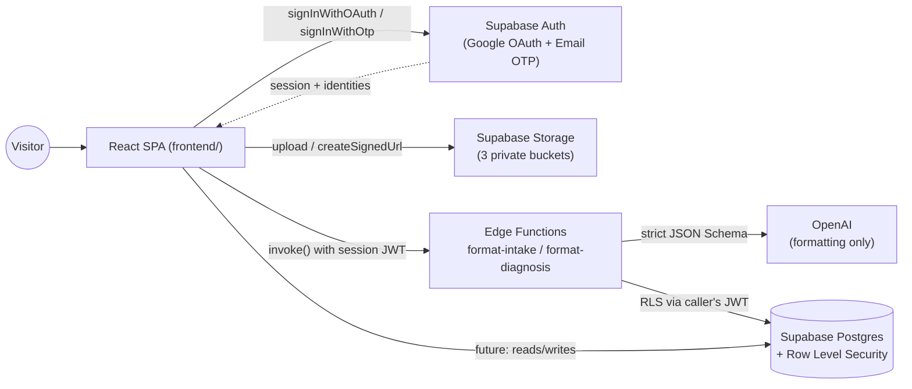
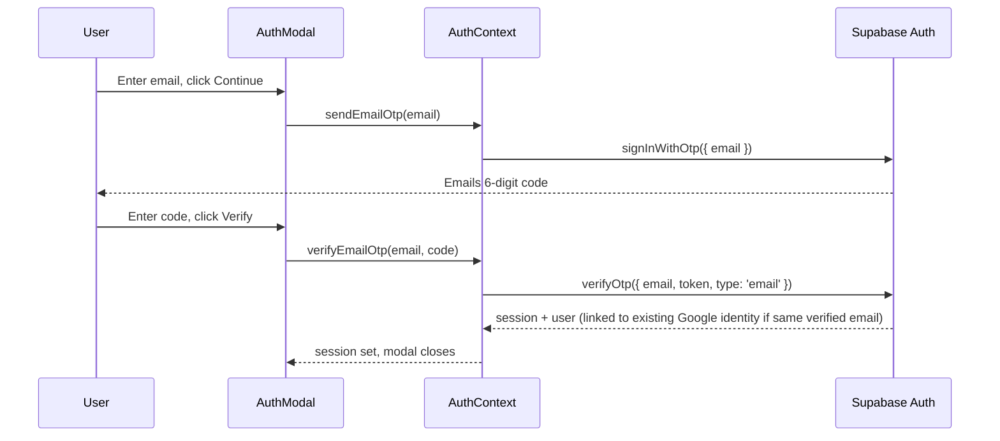

# Bynaptic Connections

**Where Signal Becomes Wisdom.**


Bynaptic Connections is a method-driven medical and technical platform structured around four core pillars:

- **Lens page** — a knowledge channel and video repository for diagnostic insights.
- **Differential page** — an algorithmic diagnostic reasoning engine and review workbench.
- **Signal Lab page** — an R&D hub for diagnostic monitors, signal tools, and clinical hardware.
- **Calibrate page** — a structured mentorship and professional development program.

This repository currently ships the marketing/application **frontend** (Vite + React SPA) integrated directly with **Supabase** for auth, storage, and (eventually) data. There is no custom backend service in this repo today — see [System Architecture](#system-architecture).

---

## Table of Contents

- [Features](#features)
- [System Architecture](#system-architecture)
- [Tech Stack](#tech-stack)
- [Environment Setup](#environment-setup)
- [Getting Started](#getting-started)
- [Available Scripts](#available-scripts)
- [Routing & Application Flows](#routing--application-flows)
- [Core Components](#core-components)
- [Design System & UI Tokens](#design-system--ui-tokens)
- [Authentication System](#authentication-system)
- [Supabase Schema, RLS & Storage](#supabase-schema-rls--storage)
- [Deployment](#deployment)
- [Development Workflow & Contributing](#development-workflow--contributing)
- [Known Issues, Limitations & Troubleshooting](#known-issues-limitations--troubleshooting)
- [Documentation Maintenance](#documentation-maintenance)
- [License](#license)

---

## Features

- **Dual-provider authentication** via Supabase Auth: Google OAuth and passwordless email sign-in (6-digit OTP code, no password field). Both resolve to the same account when they share a verified email — see [Authentication System](#authentication-system).
- **Clinician verification flow** — a country-first, 3-tier verification model (Tier A: assisted register lookup + self-attestation, Tier B: document upload + manual review, Tier C: signed attestation) that unlocks the Differential Reviews workspace and Workbench once a clinician's registration is verified.
- **Embedded Promo Video Player** — high-definition responsive HTML5 `<video>` player stage (`home-vid.mp4`, H.264 video with controls, autoplay, loop, and inline playback) integrated across `Home.jsx`, `Lens.jsx`, and `method.jsx` cinema sections, featuring a refined white dot matrix grid background (`radial-gradient(circle, #091e38 2.2px, transparent 2.8px)` with linear-gradient mask fade).
- **The Method Framework & Origin** — dedicated **Our Origin** (cream background with crisp dark navy typography) and **Our Approach** (`#091e38` dark navy background with gold icons and high-contrast white text) sections in `method.jsx`, presenting core foundational principles (*Method First*, *Evidence Over Authority*, *Systems Over Personalities*) with responsive icon cards and system-level rationale.
- **Redesigned Under Formation Stub Pages** — shared stub factory page (`underconstruction.jsx`) featuring a live system formation status badge (`SYSTEM UNDER ACTIVE FORMATION`), Playfair Display serif typography, an animated signal radar SVG graphic, and 3 feature preview cards (*Peer Verification*, *Multi-Discipline Intelligence*, *Measurable Impact*).
- **Signal Lab AI Impression Monitors** — updated research domain cards across Cardiac, Respiratory, Gastrointestinal, Circulatory, and Oxygen Response states highlighting AI-assisted clinical impressions and connection monitoring R&D.
- **Pill-styled auth modal** — Google social authentication, a two-step email + code flow, a symmetrical horizontal `OR` divider, terms/privacy legal disclaimers, and a dedicated multi-step clinician verification flow, all in one modal component.
- **In-Context Auth Flow & Smart Target Redirection** — contextual authentication modals across `Differential.jsx` and `Calibrate.jsx` that remain on the active page if the user cancels or closes (`X`) the modal, while automatically navigating authenticated or verified users directly to their destination tabs (`/profile/differential` or `/profile/calibrate`).
- **Profile dashboard** — tabbed workspace (Account & Settings, Differential Reviews, Calibrate Mentoring) with an interactive avatar upload/remove card backed by Supabase Storage.
- **Differential case flow** — a verified clinician submits case data, OpenAI reformats it into a standardized case document, the clinician approves (or edits and re-formats), an **admin** writes the actual diagnosis, OpenAI reformats *that* into a standardized report, and the clinician reads the result. OpenAI formats only — it never diagnoses, and is prompted and schema-constrained so it cannot add, infer, or silently drop clinical data. See [Differential Case Flow](#differential-case-flow-clinician-intake--openai-formatting--admin-diagnosis).
- **HUD-style callout tooltip** — animated hover tooltip (`.item-hints`) with a pulsing halo, diagonal connector line, and gradient underline, used for the Subscribe/Workbench callout.
- **Social Media Integration** — updated footer social media icons replacing Mail with Instagram (`FaInstagram` with custom linear gradient hover animation).
- **Smooth-scroll & motion** — `GSAP` for animation sequencing and `Lenis` for inertia scrolling, plus a canvas-based interactive cursor grid (`CursorGrid.jsx`).
- **Fully responsive cross-device system** — pixel-perfect CSS media queries supporting large MacBook Pro displays (1440px/1728px), standard laptops (1280px with expanded `.hero-description` max-width), small laptops/tablets (1024px with mobile drawer toggle), and common mobile phone screens (768px/480px) while keeping the desktop baseline 100% unchanged.

> Several routes in the app are intentionally **placeholder/"under construction" pages** rendered from a shared stub factory, not fully built experiences yet — see [Known Issues](#known-issues-limitations--troubleshooting) and the route table below for which ones.

---

## System Architecture

```text
Bynaptic-connections/
├── frontend/                       # Vite + React SPA — the only deployable app in this repo
│   ├── public/                     # Static public assets
│   ├── src/
│   │   ├── assets/                 # Images, circuit cards, case study visuals
│   │   │   └── vid/                # Embedded promo video assets (home-vid.mp4)
│   │   ├── components/
│   │   │   ├── Navbar.jsx          # Sticky top navigation (74px)
│   │   │   ├── Footer.jsx          # Site footer
│   │   │   ├── AuthModal.jsx       # Auth (Google + email OTP) & clinician verification modal
│   │   │   ├── ProfileUserCard.jsx # Profile card: avatar upload/remove, HUD tooltip, badges
│   │   │   ├── Card.jsx            # Generic content card primitive
│   │   │   ├── NewCaseSkeleton.jsx # Differential case intake → AI-format → approve/edit flow
│   │   │   ├── FormattedDocumentPreview.jsx # Renders the Edge Functions' JSON documents
│   │   │   ├── ScrollToTop.jsx     # Resets scroll position on route change
│   │   │   ├── SmoothScroll.jsx    # Lenis smooth-scroll provider
│   │   │   └── CursorGrid.jsx      # Canvas-based interactive cursor grid effect
│   │   ├── context/
│   │   │   └── AuthContext.jsx     # Supabase Auth provider, session state, avatar + case/diagnosis data access
│   │   ├── lib/
│   │   │   └── supabaseClient.js   # Supabase client instantiation (env-driven, dev fallback)
│   │   ├── pages/                  # One file per route (Home, Lens, SignalLab, method, etc.)
│   │   │   ├── DifferentialWorkbench.jsx    # Clinician's case list + finished diagnosis reports
│   │   │   └── AdminDashboard.jsx           # Admin console: case queue, clinician verification, calibrate
│   │   ├── App.jsx                 # Router + route table + stub-page definitions
│   │   ├── main.jsx                # React DOM entry point
│   │   └── index.css               # Global design tokens & (nearly) all component styles
│   ├── index.html
│   ├── package.json
│   ├── vite.config.js
│   └── vercel.json                 # Vercel config if this folder is set as the project root
├── supabase/                       # Supabase CLI project — deployed, and the source of truth for schema
│   ├── config.toml                 # Edge Function config (verify_jwt = true for both)
│   ├── migrations/                 # Full schema: tables, RLS, views, storage buckets + policies
│   └── functions/
│       ├── _shared/                # Auth guards, OpenAI caller, JSON Schemas + system prompts
│       ├── format-intake/          # Clinician intake → standardized case document
│       └── format-diagnosis/       # Admin diagnosis notes → standardized report
├── backend/                        # Reserved Express API skeleton — not deployed, not wired into the frontend (see backend/README.md)
├── package.json                    # Root convenience scripts (delegate to frontend/)
├── vercel.json                     # Vercel config for a zero-config deploy from repo root
└── README.md
```

The frontend talks to Supabase directly using the publishable (anon) key, and **all authorization is enforced by Supabase Row Level Security, not application code**. The one exception is the two Supabase **Edge Functions** in `supabase/functions/`, which exist solely because the OpenAI API key must never reach the browser — they still authorize via the caller's own session JWT (not the service role), so the same RLS policies apply. `supabase/migrations/` is the reproducible source of truth for the database schema; apply it to a fresh project with `supabase db query --linked -f <file>` (see `MD_files/SUPABASE_FRESH_SETUP.md`).

A minimal, runnable-but-unwired Express skeleton exists at `backend/` for future server-side needs (e.g. a real Tier A register-lookup API once a vendor contract like FSMB's is signed) — see `backend/README.md` for its status and what not to add to it yet. If it's ever actually deployed and called by the frontend, this section and the diagram below should be updated to reflect it.



---

## Tech Stack

### Runtime dependencies (`frontend/package.json`)

| Package | Version | Purpose |
|:---|:---|:---|
| `react` / `react-dom` | `^19.2.7` | UI library and DOM renderer |
| `react-router-dom` | `^7.18.1` | Client-side routing |
| `@supabase/supabase-js` | `^2.110.8` | Auth, Storage, and (future) database client |
| `lucide-react` | `^1.25.0` | Primary icon set |
| `react-icons` | `^5.7.0` | Secondary icon set |
| `gsap` / `@gsap/react` | `^3.15.0` / `^2.1.2` | Animation sequencing |
| `lenis` | `^1.3.25` | Smooth/inertia scrolling |
| `styled-components` | `^6.4.4` | CSS-in-JS, used selectively alongside the global stylesheet |

### Dev dependencies

| Package | Version | Purpose |
|:---|:---|:---|
| `vite` | `^8.1.1` | Dev server & production bundler |
| `@vitejs/plugin-react` | `^6.0.3` | React Fast Refresh for Vite |
| `oxlint` | `^1.71.0` | JS/JSX linter (`npm run lint`) |
| `@types/react`, `@types/react-dom` | `^19.2.17` / `^19.2.3` | Editor type hints (project is plain JS/JSX, not TypeScript) |

### Prerequisites

- Node.js **≥ 18.x**, npm **≥ 9.x** (verified locally against Node 24 / npm 11 as well)
- A Supabase project (free tier is sufficient) with the Google and Email providers enabled

---

## Environment Setup

Copy the tracked template and fill in real values — **do not commit the filled-in file**:

```bash
cp frontend/env.local frontend/.env.local
```

`frontend/.env.local` (note the leading dot — Vite only loads files matching `.env*`) needs:

```env
VITE_SUPABASE_URL=https://your-project-ref.supabase.co
VITE_SUPABASE_PUBLISHABLE_KEY=sb_publishable_xxxxxxxxxxxxxxxxxxxx
```

Both variables are prefixed `VITE_`, so they are bundled into client JS and shipped to every visitor — only ever put the **publishable** key here, never a secret/service-role key. If these variables are absent or still contain the literal string `placeholder`, the app runs in a **dev fallback mode**: it mocks a logged-in session locally instead of calling Supabase, so the UI is still explorable without real credentials — but no real auth, storage, or data ever gets touched in that mode.

### Server-side secrets (Edge Functions)

`OPENAI_API_KEY` is **not** a `VITE_` variable and never belongs in `.env.local` — it lives as a Supabase project secret so it stays out of the browser bundle entirely:

```bash
supabase secrets set OPENAI_API_KEY=sk-...
```

`SUPABASE_URL` and `SUPABASE_ANON_KEY` are injected into every Edge Function automatically; you don't set those. Full setup — including database schema, storage buckets, and Google/email auth configuration — is in `MD_files/SUPABASE_FRESH_SETUP.md` (gitignored, local reference only).

**`OPENAI_API_KEY` is optional.** Without it the formatting Edge Functions fall back to a deterministic offline formatter (`_shared/placeholderFormatter.ts`) so the whole differential flow runs end-to-end before a key exists. Every response carries `formatter: 'openai' | 'placeholder'`, and the UI shows a banner whenever a model did not produce the document. An optional `DIFFERENTIAL_FORMATTER` secret pins the choice:

```bash
supabase secrets set DIFFERENTIAL_FORMATTER=openai   # hard-fail if the key is missing/rotated away
supabase secrets set DIFFERENTIAL_FORMATTER=placeholder  # force offline, e.g. staging
# unset / 'auto' (default) — OpenAI when a key is present, placeholder otherwise
```

Set it to `openai` in production: under the default `auto`, an OpenAI outage silently (but visibly, via the banner) degrades to the placeholder rather than blocking submissions.

---

## Getting Started

### Installation

```bash
git clone https://github.com/arunchavan4499/Bynaptic-connections.git
cd Bynaptic-connections
npm install --prefix frontend
```

### Run the dev server

From the repo root (uses the convenience root `package.json`):

```bash
npm run dev
```

or directly from `frontend/`:

```bash
cd frontend
npm run dev
```

The app runs at `http://localhost:5173`.

---

## Available Scripts

Root `package.json` (delegates into `frontend/`):

```bash
npm run dev       # start Vite dev server
npm run build     # production build to frontend/dist
npm run preview   # preview the production build
```

`frontend/package.json` (same scripts, plus linting):

```bash
npm run dev       # Vite dev server with HMR
npm run build     # production bundle → dist/
npm run preview   # preview the production build locally
npm run lint      # oxlint code quality checks
```

There is currently no automated test script — see [Known Issues](#known-issues-limitations--troubleshooting).

---

## Routing & Application Flows

| Route | Component | Status |
|:---|:---|:---|
| `/` | `Home.jsx` | Live |
| `/method` | `method.jsx` | Live |
| `/lens` | `Lens.jsx` | Live |
| `/differential` | `Differential.jsx` | Live |
| `/research-notes` (alias: `/signal-lab` → redirects here) | `SignalLab.jsx` | Live |
| `/calibrate` | `Calibrate.jsx` | Live |
| `/collaborate` | `colaborate.jsx` | Live |
| `/advisory` | `Advisory.jsx` | Live |
| `/about` | Redirect (`Navigate to="/" replace`) | Deleted / Redirected to `/` |
| `/contact` | `Contact.jsx` | Live |
| `/profile`, `/profile/differential`, `/profile/calibrate` | `Profile.jsx` (tab pre-selected via prop) | Live |
| `/governance` and its sub-pages (`/governance/editorial-council`, `/governance/clinical-review-network`, `/governance/research-advisory-circle`, `/governance/mentoring-framework-board`) | shared stub factory | **Placeholder** |
| `/ethics-evidence` | shared stub factory | **Placeholder** |
| `/methods-library`, `/methods-library/calibrate-framework` | shared stub factory | **Placeholder** |
| `/differential/workbench` | `DifferentialWorkbench.jsx` | Live, gated behind an active clinician verification (`RequireClinicianAccess`) — case list + diagnosis detail, see [Differential Case Flow](#differential-case-flow-clinician-intake--openai-formatting--admin-diagnosis) |
| `/differential/referral` | shared stub factory | **Placeholder**, gated behind an active clinician verification (`RequireClinicianAccess`) |
| `/admin` (+ `/admin/differential-cases`, `/admin/clinician-review`, `/admin/calibrate` — the same page with a tab preselected, mirroring `<Profile defaultTab>`) | `AdminDashboard.jsx` | Live, gated on `profiles.is_admin`; linked from the Profile tab bar for admins only. Calibrate tab is a deliberate placeholder (no schema behind it yet) |
| `/privacy`, `/terms`, `/press` | shared stub factory | **Placeholder** |
| `*` (404) | `NotFound.jsx` | Live |

"Placeholder" routes render through `makeUnderConstruction()` in `pages/underconstruction.jsx` — a shared "this is coming soon" component, not a dedicated page build. Check `App.jsx` before assuming any of these routes has real content.

---

## Core Components

- **`AuthModal.jsx`** — the single modal for both general sign-in and clinician verification. General mode is structured with Google OAuth at the top, a symmetrical `OR` divider (`.auth-divider`), email input, and legal disclaimer links (`.auth-terms-note`); clinician mode (`ClinicianVerificationFlow`, in `components/clinician-verification/`) runs a country → registration details → (Tier B: documents) → declaration flow once a user is authenticated by either method. Uses React Router SPA navigation (`useNavigate()`) to route verified users directly to their destination without full page reloads.
- **`ProfileUserCard.jsx`** — avatar upload/remove (client-side resize → Supabase Storage), verified-specialist badge, and the HUD-style Subscribe/Workbench tooltip callout.
- **`AuthContext.jsx`** — the single source of truth for session state, Google/OTP sign-in, avatar upload/removal, clinician verification status, and post-login target redirection (`byn_pending_redirect`). See [Authentication System](#authentication-system).
- **`Navbar.jsx` / `Footer.jsx`** — sticky top nav with a responsive mobile navigation menu toggle (`.nav-mobile-toggle`) and slide-down drawer (`.nav-links.nav-mobile-open`), plus the site footer that adapts to 3-column and 1-column layouts across screens.
- **`NewCaseSkeleton.jsx`** — the clinician case-intake stepper (Patient Context / Clinical Signals / Tests & Data). On submit it calls the `format-intake` Edge Function and shows a read-only preview the clinician must approve — or edit and re-format — before anything is persisted. See [Differential Case Flow](#differential-case-flow-clinician-intake--openai-formatting--admin-diagnosis).
- **`FormattedDocumentPreview.jsx`** — one recursive renderer for both Edge Function outputs (case document and diagnosis report). It walks the JSON rather than hardcoding either schema's field list, so schema changes in `supabase/functions/_shared/differentialSchemas.ts` don't require touching the UI. Nulls render as an explicit "Not reported" rather than disappearing.
- **`CursorGrid.jsx`** — canvas-based cursor-reactive grid effect.
- **`SmoothScroll.jsx`** — wraps the app in a Lenis smooth-scroll instance.

---

## Design System & UI Tokens

Global tokens and media queries live in `frontend/src/index.css`:

```css
:root {
  --navy: #0d1b2e;
  --navy-light: #162337;
  --gold: #c8893a;
  --gold-light: #d9a05a;
  --blue-accent: #3b6fa0;
  --blue-bright: #4a8cc4;
  --cream: #f5f0e8;
  --cream-dark: #ede7da;
  --text-dark: #1a1a1a;
  --text-mid: #444;
  --text-light: #6b7280;
  --white: #ffffff;
  --border: #d9d0c0;
  --deep-teal: #0a2e38;
}
```

Additional scoped tokens (e.g. `--step-color`, `--domain-color`, `--accent-color`) are defined locally inside specific component style blocks, not in `:root` — search `index.css` for the component you're touching before inventing a new one.

- **Layout & Container**: `.container` caps content at `1320px` on standard desktops, scaling up to `1360px`/`1440px` on ultra-wide MacBook displays while keeping content centered.
- **Responsive Media Queries System**:
  - **Large Desktop / MacBook Pro (`>= 1440px`, `>= 1728px`)**: Max-width scaling and center alignment to prevent image/diagram stretching.
  - **Standard Laptop (`<= 1280px`)**: Side padding reduction (`20px`), navbar link gap adjustments, and hero title scaling (`42px`).
  - **Small Laptop & Tablet (`<= 1024px`)**: Mobile navbar hamburger toggle (`.nav-mobile-toggle`) & slide-down drawer (`.nav-links.nav-mobile-open`), 1-column hero stacking, 3-column footer grid, and single-column profile sidebar.
  - **Tablet & Mobile (`<= 768px`)**: Fluid typography scaling (`34px` hero titles), horizontal scrolling for filter pill bars (`.stream-filters`, `.labs-filter-bar`, `.profile-tabs`), responsive table wrappers, stacked buttons, and modal touch bounds.
  - **Common Mobile Phone Screens (`<= 480px`)**: Compact brand title, 28px hero titles, full-width stacked buttons, and vertical form controls.
- **Typography**: applied via literal `font-family` declarations (not CSS variables) — headings in `Playfair Display`, italic/descriptive copy in `EB Garamond`, UI labels and body text in `Source Sans 3`.

---

## Authentication System

Managed entirely through `AuthContext.jsx` / `AuthModal.jsx`, backed by Supabase Auth:

- **Google OAuth & Target Redirection** — `signInWithGoogle()` redirects to the current page (`window.location.href`) rather than a fixed origin, so the user's place in the app survives the OAuth round trip. If the user opened the modal in "clinician" mode, that intent is stashed in `sessionStorage` (`byn_pending_auth_mode`). Any target redirect URL (e.g. `/profile/calibrate` or `/profile/differential`) is persisted in `sessionStorage` (`byn_pending_redirect`) and executed upon sign-in across both real OAuth callbacks and dev fallback mode.
- **Cancel & Dismissal Safety** — closing or cancelling the auth modal (`closeAuthModal()`) clears any stashed pending action or redirect (`byn_pending_redirect`), closing the modal overlay immediately while keeping the visitor on their active page (`/differential` or `/calibrate`) without triggering unwanted route changes or showing unauthenticated error states.
- **Email OTP** — `sendEmailOtp(email)` / `verifyEmailOtp(email, code)` implement a passwordless, two-step "enter email → enter 6-digit code" flow (`supabase.auth.signInWithOtp` / `verifyOtp`, `type: 'email'`). There is no password field anywhere in the app.
- **Identity linking is not symmetric** — read this before changing either flow:
  - Email OTP first, Google second (same email): links automatically — Supabase matches OAuth sign-ins to an existing verified-email user.
  - Google first, then email OTP second (same email): expected to also resolve to the same account, since `verifyOtp()` only completes after the email is proven owned — but this direction isn't explicitly documented by Supabase (their docs focus on the OAuth-second case), so treat it as a tested assumption, not a guarantee, if you touch this code.
- **Dev fallback** — when Supabase env vars are missing/placeholder (see [Environment Setup](#environment-setup)), every auth function mocks a local session instead of calling Supabase, so the UI remains explorable without credentials.
- **Avatar storage** — `uploadAvatar()` / `removeAvatar()` in `AuthContext.jsx` upload to the `profile-avatar` Supabase Storage bucket under `{user_id}/avatar.<ext>`, then read back via a signed URL (private bucket, 7-day TTL) rather than a public URL. The signed URL is refreshed on every session load since it expires.
- **Clinician verification** — a country-first, 3-tier model (see [Clinician verification](#clinician-verification-bynaptic-differential-access-gate)) backed by an append-only `clinician_attestations` table, not a `user_metadata` flag. `clinicianAccessStatus` (`'none' | 'active' | 'pending' | 'rejected' | 'expired_reattestation_required'`) is derived from the latest signed attestation, re-computed client-side on every session load (annual re-attestation + forced re-sign on declaration-version change — see [Known Issues](#known-issues-limitations--troubleshooting) for why this is client-side only today). `isVerifiedDoctor` is kept as a backward-compatible boolean equal to `clinicianAccessStatus === 'active'`.



---

## Supabase Schema, RLS & Storage

There is no custom API layer — the frontend reads/writes Supabase directly, protected by Row Level Security (RLS). The schema below reflects the project's setup notes (kept locally in `MD_files/`, which is **gitignored** — see [Known Issues](#known-issues-limitations--troubleshooting)) and the tables/buckets actually referenced by the frontend code today.

### `profiles` table (planned; not yet read by the frontend)

```sql
create table if not exists public.profiles (
  id uuid primary key references auth.users(id) on delete cascade,
  email text unique not null,
  full_name text,
  avatar_url text,
  role text not null default 'user',
  is_admin boolean not null default false,
  onboarding_completed boolean not null default false,
  last_login_at timestamptz,
  created_at timestamptz not null default now(),
  updated_at timestamptz not null default now()
);

alter table public.profiles enable row level security;

create policy "read own profile" on public.profiles
  for select using (auth.uid() = id);

create policy "update own profile" on public.profiles
  for update using (auth.uid() = id) with check (auth.uid() = id);
```

The app currently reads/writes user profile data through `auth.users.user_metadata` (via `supabase.auth.updateUser`), not this table — `profiles` is provisioned for future Lens/Signal Lab content ownership, not yet wired into the frontend.

### `profile-avatar` Storage bucket (in use today)

- **Private** bucket; the app reads avatars via time-limited signed URLs, never a public URL.
- Object path convention: `{user_id}/avatar.<ext>`.

```sql
create policy "read own avatar" on storage.objects for select
  using (bucket_id = 'profile-avatar' and auth.uid()::text = (storage.foldername(name))[1]);

create policy "write own avatar" on storage.objects for insert
  with check (bucket_id = 'profile-avatar' and auth.uid()::text = (storage.foldername(name))[1]);

create policy "update own avatar" on storage.objects for update
  using (bucket_id = 'profile-avatar' and auth.uid()::text = (storage.foldername(name))[1]);

create policy "delete own avatar" on storage.objects for delete
  using (bucket_id = 'profile-avatar' and auth.uid()::text = (storage.foldername(name))[1]);
```

### Clinician verification (Bynaptic Differential access gate)

`/differential/workbench` and `/differential/referral` are gated behind an **active** clinician
verification (`RequireClinicianAccess`), per a country-first, 3-tier model: Tier A (assisted
register lookup + self-attestation — no country has a real automated API, see
`frontend/src/lib/registerAdapters.js`), Tier B (document upload + manual review), Tier C (signed
attestation only, the primary tier for this business). Unlike every other table in this schema,
`clinician_attestations` and `clinician_attestation_reviews` are **fully append-only** — no
`update`/`delete` policy exists for any role, including admins; re-attestation (annual, or forced
on a declaration-wording change) inserts a new row rather than editing the old one. Full schema,
RLS, and the `clinician-documents` Storage bucket are documented in
`MD_files/SUPABASE_AUTH_AND_DB_SETUP.md` §12 (gitignored, local reference only — see
[Known Issues](#known-issues-limitations--troubleshooting)). A minimal, direct-URL-only Tier B
review surface lives at `/admin/clinician-review`, gated on `profiles.is_admin`.

Note that `profiles` uses **column-level grants** on top of RLS: `authenticated` may update only `full_name`, `institution`, `marketing_opt_in`, `avatar_url`, `onboarding_completed`, and `updated_at`. `is_admin` and `role` are deliberately not grantable — the row-level policy alone would have let any user promote themselves to admin on their own row, since that check only constrains *which row* you may write, not which columns.

### Differential Case Flow (Clinician Intake → OpenAI Formatting → Admin Diagnosis)

`NewCaseSkeleton.jsx` submits a clinician's raw case data to a Supabase Edge Function
(`format-intake`) only when free-text prose needs tidying. **Intake is structured**: the form
captures the reference report's checkbox sections (Temporal Factors, Frequency, Timing, Onset,
Location, Characteristics, Duration) directly, and `lib/differentialCaseDocument.js` maps them to
the report document deterministically — so the model is no longer inferring structure from prose.
The clinician approves a preview before it's inserted into `differential_cases`.

An admin reviews the case at `/admin/differential-cases`, runs the **rule-based reasoning engine**,
writes the actual diagnosis, and that goes through `format-diagnosis` before being inserted into
`differential_diagnoses`. The clinician reads and prints the finished report at
`/differential/workbench`. Both tables are **fully append-only** — a diagnosis is a new row, never
an edit, and status is derived by a view rather than stored as a mutable column. `OPENAI_API_KEY` is
a Supabase project secret — the browser never sees it, and it is optional (see
[Server-side secrets](#server-side-secrets-edge-functions)).

#### Cases are de-identified

Per the workbench prototypes in `ProjectPlan/Differential_plan/` — *"Enter de-identified clinical
details. Avoid patient name, phone number, address, Aadhaar, passport, or direct identifiers"*, with
a patient field of **"Age only"** — a case carries age, sex, and clinical detail. There is no name,
date of birth, contact detail or record number: not in the form, not in `CASE_INTAKE_SCHEMA`, not in
`differential_case_index`. The reference PDF (`patient-result_14.pdf`) does show those fields, but it
is a third-party report layout, not a specification of what Bynaptic collects; **we follow its
structure and drop its identifier block.**

Three things enforce this rather than merely requesting it:

1. **Two separate attestations**, `consent_confirmed` and `deidentification_confirmed`, both
   required by a check constraint on `differential_cases`. They are distinct claims — a clinician can
   hold consent and still have failed to strip identifiers — so they are not one tickbox.
2. **The schema has nowhere to put an identifier**, and `CASE_INTAKE_SYSTEM_PROMPT` explicitly tells
   the model to drop any it finds rather than relocate it into a free-text field.
3. **An admin quarantine action** (`differential_case_flags`, append-only, reason ≥10 chars). A human
   noticing is the only realistic enforcement point — attachments carry names in headers and
   metadata — so the reviewer can withhold a case from review and tell the clinician why. Nothing is
   deleted; the clinician resubmits a scrubbed version.

`case_ref` (`BDW-2026-0001`, server-issued) is the clinician's link back to their own patient. They
hold that mapping; this system never does.

#### Structured reasoning is rule-based, not AI

`lib/differentialEngine.js` + `lib/differentialRules.js` score a case against 25 clinical pathways
(68 symptoms, 10 red flags) lifted from `Bynaptic_Diagnostic_Reasoning_App.html`. It runs
**client-side, admin-only, at review** — no network call, no Edge Function invocation, no cost. The
referring clinician never sees a ranked differential, so neither party is anchored before an expert
has looked at the case.

Every ranked pathway shows the words that triggered it. That visible trail is the point: *"this rule
fired because the note contains 'thunderclap'"* is defensible in a way *"the model said so"* is not.
It is decision support and never decides — `rule_pack_version` and the raw `engine_output` are stored
on the diagnosis so any output can be reproduced later.

Four defects in the prototype scorer are fixed and regression-tested, because each was a clinical
safety issue rather than a display bug:

| Fix | Prototype behaviour |
|---|---|
| Word-boundary matching | `includes()` matched `ms` inside "sympto**ms**" and `tia` inside "ini**tia**lly" |
| Negation handling | *"denies chest pain. No palpitation. No fever."* ranked **8 pathways, ACS first** |
| Score normalisation | A 20-keyword rule outranked a 5-keyword one on equal evidence |
| Red flags are absolute | Ranked alongside pathway guesses instead of escalating unconditionally |

Negation is deliberately conservative — it stops at commas, so *"denies chest pain, fever"* still
scores *fever*. Failing to negate leaves a spurious pathway the reviewer dismisses; over-negating
would silently **remove** a candidate, which is far more dangerous. Pathways whose every hit was
negated are reported separately under `excludedByNegation` rather than vanishing.

#### Triage

Red-flagged cases do not wait their turn. The `differential_case_intake_defaults` trigger recomputes
`red_flag_count` from the submitted array and forces `urgency = 'urgent'` — a client that ticks three
red flags and posts `red_flag_count: 0` is overwritten, so the queue is trustworthy. Ordering uses a
generated `triage_rank` column, because `order by urgency` sorts the text alphabetically
(`priority, routine, urgent`) and would put the urgent cases **last**.

#### Reviewer drafts

`differential_case_drafts` is **mutable**, one row per reviewer per case, RLS-scoped so no admin sees
another's unfinished reasoning. It exists because `differential_diagnoses` has no UPDATE policy by
design and a reasoning session is long; relaxing append-only to allow work-in-progress would destroy
the property that makes the record trustworthy. The draft is deleted when the diagnosis is submitted.

#### The differential API surface

There is no bespoke HTTP API. Two Edge Functions exist because they need a server-side secret;
everything else goes straight to PostgREST under RLS, which costs no function invocation.

| Operation | Endpoint | Auth |
|---|---|---|
| Format raw intake | `POST /functions/v1/format-intake` → `{ formattedCase, formatter, unmapped, degraded? }` | active clinician |
| Format a diagnosis | `POST /functions/v1/format-diagnosis` → `{ formattedDiagnosis, formatter, unmapped, degraded? }` | admin |
| Submit an approved case | `POST /rest/v1/differential_cases` | RLS: active clinician, own row |
| List cases (clinician or admin queue) | `GET /rest/v1/differential_case_index` | RLS |
| Open one case | `GET /rest/v1/differential_case_detail?case_id=eq.<id>` | RLS |
| Submit a diagnosis | `POST /rest/v1/differential_diagnoses` | RLS: admin |
| Read own access status | `POST /rest/v1/rpc/my_clinician_access_status` | authenticated (reports on caller only) |
| Save/restore reviewer draft | `POST/GET /rest/v1/differential_case_drafts` | RLS: admin, own drafts only |
| Quarantine / release a case | `POST /rest/v1/differential_case_flags` | RLS: admin; reason ≥10 chars |
| Log a case access | `POST /rest/v1/differential_case_access_log` | RLS: insert-only, never readable from the browser |

The reasoning engine is **not** in this table: it is a pure client-side function with no network
call and no server cost.

Both Edge Functions cap request bodies at 256kB and reject empty intakes, so an oversized or blank
POST cannot be billed through to OpenAI.

#### Reads are split index/detail (cost)

Supabase bills egress per GB, so the read path is deliberately two-tier:

- **`differential_case_index`** — one short row per case: id, timestamps, status, attachment count,
  and patient name/age/gender as scalars. **Measured at 299 bytes/case.**
- **`differential_case_detail`** — the full case and diagnosis documents, fetched for **one** case
  when it is expanded. Measured at 3,050 bytes/case. It deliberately omits `raw_intake`, which
  nothing renders and which roughly doubles the row.

For comparison, on the same case the admin queue's old `select('*')` was **4,874 bytes**, and the
old `differential_case_status` path was 2,916 — both fetched for *every* case on page load, with
the admin queue then discarding the already-diagnosed ones in the browser. Lists now filter and
paginate in Postgres (25/page). `differential_case_status` is retained but **superseded**; new code
should use the index/detail pair.

Both new views are `security_invoker = true` — without it a view runs as its owner and bypasses
the RLS gate on `differential_cases` entirely.

#### Attachments

Uploaded to `differential-case-attachments` under `{user_id}/{case_id}/{nn-sanitised-name}`, read
back through signed URLs with a **5-minute** TTL (not the 7 days used for avatars: a signed URL is
authorised when minted and keeps working after a revocation, so the TTL is the only bound on that
window). Client-side limits: 10 files per case, 25MB each.

Attachments must be uploaded *before* the case row is inserted, because `differential_cases` has no
UPDATE policy and `attachment_paths` cannot be filled in afterwards. Two things stop that orphaning
patient documents: a pre-flight `my_clinician_access_status()` check before anything is uploaded
(catching the failure that actually happens — verification denied), and a storage DELETE policy
scoped to objects in the caller's own folder for which **no `differential_cases` row exists**. Once
the case row lands its attachments are immutable, including seconds later for the case just
submitted.

#### Access log and erasure

`differential_case_access_log` records who opened which case, and when — required by
`FORM_ACTIONS_AND_MAIL_ROUTING.md`'s "access control and audit logs" for the clinical portal.
De-identified is not anonymous: a case with a date of examination, an age, a referring clinician and
an institution is re-identifiable by anyone holding that clinic's records, and the log is the only
way to answer "who looked at this?" after a quarantine or a compromised account.

It is **insert-only and never readable from the browser** — no SELECT grant and no SELECT policy for
`anon` or `authenticated`, so it is queryable only via the service role. `actor_id` and `actor_role`
are derived server-side by trigger, so a caller cannot manufacture a record naming someone else.
One insert per case *opened*; list renders are not logged, which would be noise rather than signal.

**Erasure runbook.** `differential_cases.clinician_id` and `clinician_attestations.user_id` are
`ON DELETE RESTRICT`, so Supabase Dashboard → "Delete user" **fails** for any clinician who has
submitted a case or signed an attestation. That is intentional — a single dashboard click must not
destroy patient records and their audit trail — but it means erasure is an anonymise procedure, not
a delete:

1. Never hard-delete `clinician_attestations` or `differential_cases`. Revoke access with an
   append-only `clinician_attestation_reviews` row (`decision = 'revoked'`, reason ≥10 chars).
2. To erase a clinician's identity while retaining the clinical record: null the identifying columns
   on `clinician_attestations` (`full_legal_name`, `contact_email`, `registration_number`), and clear
   `profiles.full_name` / `avatar_url`. The case rows keep their `clinician_id` FK.
3. Case content is already de-identified, so patient erasure is normally not applicable. If a case
   is found to contain identifiers, quarantine it (§ above) and null the offending
   `structured_intake` / `formatted_case` keys — the row and its audit trail stay.
4. Storage objects are not reached by Postgres FKs. Remove attachments explicitly via the Storage
   API before considering an erasure complete.

### Contact form routing

The contact page lists **no email addresses and no phone number**. It previously exposed ten
mailboxes plus a `tel:` link in the info card and an eleventh address as the form's fallback — all
of them in the shipped bundle and readable by anything that fetched the page.

Routing is now server-side. The browser posts **opaque tokens** (`pathway`, `subRoute`) to the
`contact-submit` Edge Function, which resolves them to a mailbox in
`supabase/functions/_shared/contactRouting.ts` — the only place in the repo where these addresses
exist. Do not import that module into anything under `frontend/`.

| Pathway | Sub-route | Routed to |
|---|---|---|
| Clinicians | — | Differential |
| Researchers | General / Existing production partner | Signal Lab / Signal Lab partnerships |
| Calibrate | General / Individual / Institution | Calibrate desks |
| Partners & Press | — | Lens |

A fallback address is disclosed in exactly one circumstance: a **5xx** response, where the send
genuinely failed and the sender would otherwise be stranded. It arrives at runtime in the error
body and is never bundled. Validation errors (4xx) don't reveal one — retrying the form is the fix.

**Regression test for the core requirement**, worth running after any change to this page:

```bash
npm run build --prefix frontend
grep -rioE "[a-z0-9._-]+@bynapticconnections\.com|tel:\+?[0-9]+" frontend/dist/
# must return nothing
```

#### `contact-submit` is public, and that shapes its design

It is the only Edge Function with `verify_jwt = false` — visitors are not signed in. A public,
unauthenticated endpoint that sends email is an open-relay shape, so four controls are load-bearing:

1. **The recipient never comes from the request.** Resolution happens server-side from the tokens.
   Posting a `to`/`destination` field has no effect.
2. **No submitted value reaches a mail header.** Control characters are stripped from every field
   (a newline in the name is an arbitrary-header injection, including `Bcc`), the subject contains
   no user content at all, and `reply_to` carries the bare validated address with no display name —
   display names need quoting, and quoting is where these bugs live.
3. **Rate limited** to 5/hour per hashed IP. The IP is peppered and hashed, never stored raw.
4. **Honeypot** field, positioned off-screen rather than `display:none` (which bots detect).

Sub-route lookups use an explicit `hasOwnProperty` guard: a bare `subRoutes[key]` resolves
inherited members, so `subRoute: "__proto__"` returns `Object.prototype` and the destination
becomes `"[object Object]"` — reachable by anyone, on a public endpoint.

#### Submissions are stored before they are sent

`contact_submissions` has **no INSERT policy for any browser-facing role** and `anon` holds no
privilege on it at all. The Edge Function writes with the service role, so the only path to a row is
through the function — where the rate limit, honeypot and routing map live. Admins read the queue
via `private.is_admin()`.

The row is written **before** the provider call, so a Resend outage never loses an enquiry: it
persists as `failed` with the error, and the sender gets the fallback address. This is also where
the success screen's reference (`BC-2026-0001`) comes from — previously it claimed a "tracking code"
had been dispatched when the form sent nothing whatsoever.

```bash
supabase secrets set RESEND_API_KEY=re_...
supabase secrets set CONTACT_FROM_ADDRESS=noreply@bynapticconnections.com   # optional
supabase secrets set CONTACT_IP_SALT=<random string>                        # optional
supabase functions deploy contact-submit
```

Without `RESEND_API_KEY` the function stores the enquiry and returns a 502 with the fallback
address. It deliberately does **not** report success — nothing reaches a human inbox, and saying
otherwise would repeat the exact failure this replaced.

### Auth provider configuration

- **Google**: OAuth provider enabled, redirect URLs configured for local + production origins.
- **Email**: OTP-based — the Magic Link email template must have its confirmation-link markup replaced with `{{ .Token }}` so users receive a 6-digit code, not a link (see `MD_files/SUPABASE_AUTH_AND_DB_SETUP.md`).
- **Custom SMTP** recommended for production sending volume — Supabase's built-in mailer is throttled to a handful of emails/hour and is documented as dev/test-only.

---

## Deployment

Deployed to **Vercel**. Two configs exist:

- `/vercel.json` (repo root) — for a zero-config deploy with the Vercel project root set to the repo root: `cd frontend && npm install && npm run build`, output `frontend/dist`, SPA rewrite to `index.html`.
- `frontend/vercel.json` — for a deploy with the Vercel project root set directly to `frontend/`: `npm run build`, output `dist`, plus a permanent redirect from `/signal-lab` to `/research-notes`.

Only one of these is actually consulted depending on how the Vercel project's root directory is configured — check the Vercel dashboard settings for this project before assuming which one is live. Required environment variables in Vercel: `VITE_SUPABASE_URL`, `VITE_SUPABASE_PUBLISHABLE_KEY` (see [Environment Setup](#environment-setup)), plus Custom SMTP configuration on the Supabase side if production email volume matters.

---

## Development Workflow & Contributing

1. **Follow the existing design tokens** in `index.css` rather than introducing new ad-hoc colors/spacing — search for an existing token or component class first.
2. **Wrap page content in `.container`** (1320px max-width) to match the rest of the site.
3. **Validate before committing**:
   ```bash
   npm run build
   npm run lint
   ```
4. **Auth changes are cross-cutting** — `AuthContext.jsx` is shared by the modal, the profile page, and the avatar card. Re-read [Authentication System](#authentication-system) before changing sign-in behavior, and re-test both Google and email-OTP paths (and the linking direction between them) after any change.
5. **Git workflow**: this repo has had real merge conflicts between parallel work on `AuthModal.jsx` / `AuthContext.jsx` / `index.css` — when merging, confirm which side owns which concern (visual design vs. auth logic) rather than blindly taking one side wholesale.

---

## Known Issues, Limitations & Troubleshooting

- **No automated tests and no CI** — nothing runs `npm run build`/`lint` automatically on push or PR. Run them locally before pushing.
- **Many routes are placeholders** — see the "Placeholder" rows in [Routing & Application Flows](#routing--application-flows); they render a generic "under construction" stub, not real content.
- **Client-side gating is a UX convenience, not a real security boundary** — `RequireClinicianAccess` and the Profile tab both check `clinicianAccessStatus` client-side; the real enforcement is server-side RLS on `clinician_attestations` and, since the [Differential Case Flow](#differential-case-flow-clinician-intake--openai-formatting--admin-diagnosis) landed, on `differential_cases`/`differential_diagnoses` too.
- **OpenAI formatting, not diagnosis** — both Edge Functions (`format-intake`, `format-diagnosis`) are prompted to strictly reformat clinician/admin-authored text into a schema, never to infer or add clinical content; the admin is the only party that diagnoses. Verify this holds under real-world inputs before treating the output as trustworthy for anything beyond display formatting.
- **Re-attestation is enforced at read time, not by a scheduled job** — there is no cron in this stack. Annual expiry and forced re-sign-on-version-bump are evaluated server-side by `private.clinician_access_status()` on every request that touches the gate (RLS policies, the Edge Function guard, the status RPC), so a lapse takes effect on the next call rather than at a fixed nightly moment. Nothing sweeps or notifies in advance.
- **De-identification is attested, not automatically verified** — the database enforces that both attestations were made, and the schema has no field to hold an identifier, but nothing scans free-text or attachments for a name that slipped through. The quarantine action exists because a reviewer noticing is the real enforcement point. Treat automated PII detection on uploads as unbuilt.
- **The rule pack is bundled, so changing a rule needs a developer and a redeploy** — `RULE_PACK_VERSION` is recorded on every diagnosis so outputs stay reproducible, but there is no admin editing UI. `loadRulePack()` exists as the seam to move it to a table later.
- **The reasoning engine's negation handling is deliberately conservative** — it stops at clause boundaries, so `"denies chest pain, fever"` still scores *fever*. Erring toward a spurious pathway the reviewer dismisses is safer than silently removing a candidate, but it does mean list-style negations are only partly handled.
- **The offline formatter is a fallback, not a substitute** — with no `OPENAI_API_KEY`, `placeholderFormatter.ts` maps only the intake fields that correspond one-to-one to a schema field and parses explicitly-labelled vitals (`BP:`, `HR:`, …). It never infers: an unlabelled number, a diagnostic question, or an intake field the schema has no home for is reported in `unmapped` and left null rather than guessed. The clinician's original text is always persisted in `differential_cases.raw_intake`, so nothing is lost, but a placeholder-formatted document is substantially emptier than an OpenAI-formatted one and the preview says so.
- **The admin queue scans, by design** — `differential_case_index.status` is derived from a lateral join, so `status = 'submitted'` cannot use an index and Postgres scans `differential_cases`. This is still far cheaper than the previous behaviour (the filter and the 25-row page happen in the database rather than the browser), but at high case volume the queue will want a real `diagnosed_at` column on `differential_cases`, maintained by trigger, with a partial index. Not worth doing at current volume.
- **Tier A is not a real automated register lookup** — GMC/AHPRA/India's NMC have no usable public API; Tier A today is an assisted link-out to the official register plus the same self-attestation as Tier C (see `frontend/src/lib/registerAdapters.js`).
- **`MD_files/` (including the Supabase/DB setup notes) is gitignored** — the schema/RLS/auth setup documentation referenced in this README is **not version-controlled**. Anyone else on the team won't see it in `git log` or on GitHub; treat it as local reference only until it's moved into a tracked location.
- **Large JS bundle** — production build emits a single ~860 kB JS chunk (Vite warns above 500 kB). Not yet code-split; consider `dynamic import()` for heavy routes (Differential, Lens) if load time becomes a problem.
- **Supabase built-in mailer rate limits** — without Custom SMTP configured, expect "email rate limit exceeded" errors during active local testing of the OTP flow; either wait out the window or finish Custom SMTP setup (see `MD_files/SUPABASE_AUTH_AND_DB_SETUP.md`).
- **A ~67 MB video (`frontend/src/assets/vid/home-vid.mp4`) is committed to git**, which is most of the repo's ~127 MB `.git` size and is downloaded in full on every fresh clone. It's under GitHub's 100 MB hard limit so pushes still work, but this is permanent — removing it later requires a history rewrite (`git filter-repo`) and a force-push. If more video is coming, move to Git LFS or host the assets externally before adding them.
- **Supabase Edge Functions are deployed separately from the frontend** — a Vercel deploy does *not* ship them. After changing anything in `supabase/functions/`, run `supabase functions deploy <name>`, or the browser will keep calling the old version.
- **No `LICENSE` file** — see [License](#license).

---

## Documentation Maintenance

**[`docs/NEED_TO_IMPLEMENT.md`](docs/NEED_TO_IMPLEMENT.md) — deployment runbook.** What is written
but not yet live, and how to make it live: deploying the three Edge Functions (none are deployed
today, which is why the contact form currently fails), the Resend setup, custom SMTP so registration
emails come from Bynaptic rather than Supabase's throttled shared mailer, and the Google Cloud
consent-screen work. Tracked in git and free of secret values, unlike `MD_files/` which is
gitignored and local-only.

This README is the source of truth for setup, architecture, and auth behavior. Suggested (not automated) practice:

- **Update in the same PR** as any change to routing, auth flows, Supabase schema/RLS, or the tech stack — don't let this drift the way the previous version did (it still described password-based auth and a `--font-serif` CSS variable that never existed).
- **Quarterly audit**: re-check the [Routing table](#routing--application-flows) against `App.jsx`, the [Tech Stack](#tech-stack) table against both `package.json` files, and the [Known Issues](#known-issues-limitations--troubleshooting) list against reality.
- **Review checklist before merging a docs change**: (1) every code snippet still matches the actual source, (2) every file path mentioned still exists, (3) no claimed feature is actually a placeholder/stub, (4) version numbers match `package.json`.
- No changelog file or generator is set up yet — commit messages and `git log` are the current record of what changed and why.

---

## License

No `LICENSE` file is currently present in this repository. Until one is added, treat this codebase as **all rights reserved** — do not assume MIT/Apache/etc. permissions.


# FER Local — Facial Emotion Recognition (Prototype)
# FER Local

A local, webcam-based **Facial Emotion Recognition (FER)** demo with an explainability overlay.

The app runs a FastAPI backend and serves a browser UI that captures frames from your camera, predicts an emotion label, and returns a Grad-CAM heatmap rendered on top of the detected face.

## Features

- Real-time webcam capture (auto or manual mode)
- Emotion prediction API (`/infer`)
- Face detection + crop using OpenCV Haar cascade
- Grad-CAM heatmap generation and overlay
- Model metadata endpoint and hot reload endpoint
- Single local service that serves both backend and frontend

## Project Structure

- `/home/runner/work/fer-local/fer-local/backend/app.py` – FastAPI app and API routes
- `/home/runner/work/fer-local/fer-local/backend/model.py` – model loading, preprocessing, prediction, Grad-CAM
- `/home/runner/work/fer-local/fer-local/backend/face.py` – face detection and cropping
- `/home/runner/work/fer-local/fer-local/frontend/index.html` – UI layout
- `/home/runner/work/fer-local/fer-local/frontend/main.js` – webcam flow, API calls, UI interactions
- `/home/runner/work/fer-local/fer-local/frontend/styles.css` – styling
- `/home/runner/work/fer-local/fer-local/models/mobilenetv2_fer.h5` – FER model file
- `/home/runner/work/fer-local/fer-local/run_dev.sh` – local startup script

## Requirements

- Python 3.8+
- Webcam/browser access
- OS packages required by TensorFlow/OpenCV (platform-dependent)

Python dependencies are listed in `/home/runner/work/fer-local/fer-local/requirements.txt`.

## Quick Start

From `/home/runner/work/fer-local/fer-local`:

## Quickstart (dev)
1. Make sure you have Python 3.8+ installed.
2. From project root:
```bash
# make sure file permissions allow running
chmod +x run_dev.sh
./run_dev.sh
```

Then open:

- `http://localhost:8000`

## Manual Run (without script)

```bash
python3 -m venv .venv
source .venv/bin/activate
pip install --upgrade pip
pip install -r requirements.txt
uvicorn backend.app:app --host 0.0.0.0 --port 8000 --reload
```

## Environment Variables

Configured in `.env` (loaded by `python-dotenv`):

- `HOST` (default `0.0.0.0`)
- `PORT` (default `8000`)
- `FER_MODEL_PATH` (default `models/mobilenetv2_fer.h5`)

## API Endpoints

- `GET /` – serves the frontend
- `GET /health` – health check
- `GET /model-info` – current model metadata
- `POST /reload-model` – reload model from disk
- `POST /infer` – infer emotion from uploaded image
  - Request: `multipart/form-data`, field name `image`
  - Response: `{ label, prob, heatmap }`

## Inference Flow

1. Frontend captures a video frame.
2. Frame is sent to `POST /infer`.
3. Backend detects the largest face.
4. Face crop is preprocessed to match model input.
5. Model predicts emotion class probabilities.
6. Grad-CAM heatmap is generated (if conv layer is found).
7. Heatmap is overlaid on the original frame and returned as a base64 PNG.

## Notes

- If no face is detected, the API returns label `No Face` and the original frame image.
- If the model file is missing or fails to load, the backend falls back to a synthetic MobileNetV2-based demo model.
- `run_dev.sh` can start HTTPS if `./certs/key.pem` and `./certs/cert.pem` exist.

## Troubleshooting

- **Camera permission denied**: allow camera access in your browser.
- **`/infer` errors**: verify TensorFlow/OpenCV installed successfully.
- **Model not loading**: check `FER_MODEL_PATH` and model file compatibility.
- **Slow startup**: first TensorFlow load/warm-up can take time.